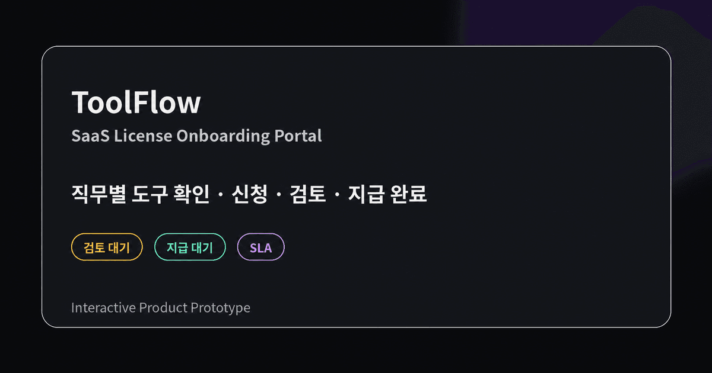

# ONBOARD·OS

[](https://github.com/dohyunkimmm/onboardos/actions/workflows/e2e.yml?query=branch%3Amain)

**신규 입사자가 직무별 업무 도구를 확인하고, 라이선스 신청부터 승인·지급 완료까지 체험하는 온보딩 포털 프로토타입입니다.**

[직접 체험](https://onboardos-rho.vercel.app/) · [2–3분 체험 안내](docs/DEMO_WALKTHROUGH.md) · [Case Study](https://app.notion.com/p/08d21460c934838cb66601b681e85d8c)

> **Portfolio release — v18.0.0 / P6 product-review candidate.**
>
> 2026-10-08 제품 검토 1~7을 반영한 후보 상태입니다. 기존 v18.0.0 릴리스 검증 자료는 당시 버전의 기록입니다. 이 자료를 이번 후보 변경 전체의 E2E·시각 회귀·Production 검증 완료로 해석하지 않습니다.

## 핵심 사용자 흐름

`가상 SSO → 직무 선택 → 공통·직무별 라이선스 확인 → 신청 → IT 검토·관리자 승인 → 지급 완료`

- **직무별 도구:** 간결한 직무 선택 메뉴, 전사 공통·직무별 라이선스, 필수·선택 및 준비 상태 구분. **공통 5개 + 직무별 38개 = 총 43개** (기존 핵심 18개 + 직군별 확장 20개, 중복 없이 집계)
- **AI 추천(직군 + 업무 케이스):** 직군만 선택해도 기본 추천을 표시하고, 업무 케이스(PDF 편집·디자인 등) 및 짧은 자연어로 다른 직군 도구도 탐색. Gemini는 외부 전송 동의 후 자동 호출, 직군 외 라이선스는 IT 예외 요청으로만 연결
- **신청·추적:** 신청 목적·권한·기간 입력, 요청번호·상태·SLA·처리 이력 확인
- **관리자 체험:** [리뷰어 모드](https://onboardos-rho.vercel.app/?review=1)에서 검토, 승인·반려, 보완 재신청, 지급 완료 처리
- **예외 대응:** 직무 미매핑·목록 외 요청, 세션 복원, 직무별 시나리오 상태 격리
- **접근성·반응형:** 키보드 조작, 스크린 리더 대응, 데스크톱·모바일 경험

## 실제 연동 범위

이 프로젝트는 **가상 데이터 기반 인터랙티브 프로토타입**입니다.

Google SSO, Google Workspace 조직 정보, Jira Service Management 티켓, SaaS 계정·라이선스 발급은 모의 흐름이며 실제 시스템과 연결되지 않습니다. 실제 회사의 라이선스 좌석·비용·설치 배포도 연동하지 않았습니다. 단, 선택형 AI 추천은 서버 환경변수로 활성화한 경우에만 외부 Gemini API를 실제 호출합니다. 모의 SSO가 서버 인증을 제공하지 않으므로 실사용 직원 정보·기밀을 입력하지 않습니다.

상태는 브라우저 `sessionStorage`에 시나리오별로 유지됩니다. SLA는 데모 정책이며 영업일 계산에서 주말만 제외합니다.

## 구현·검증

- **기술:** HTML, CSS, Vanilla JavaScript, Vercel Functions(선택형 Gemini 추천 API), Playwright, axe, Lighthouse
- **품질:** 신청·관리자 흐름, 접근성, 시각 회귀, 복구·보안, 크로스 브라우저, 성능 검사
- **배포·검증 절차:** `main` → Vercel Production. SHA-256 무결성·브라우저 Smoke 결과는 대상 배포의 별도 검증 기록을 기준으로 판단
- **기록:** GitHub Actions에서 자동 검증 결과와 릴리스 근거를 확인할 수 있습니다. 공개 정적 자산은 SHA-256으로 비교하고, 서버 함수는 응답 계약으로 별도 확인합니다.

```bash
npm ci
npm run quality
npm run test:e2e
```

## 자세히 보기

- [저장소 보호·커밋 서명·운영 검증 상태](docs/REPO-OPERATIONS.md) · [커밋 서명 설정](.github/COMMIT_SIGNING.md)
- [2–3분 체험 안내](docs/DEMO_WALKTHROUGH.md) · [AI 추천 설정·제약](docs/AI-RECOMMENDATION.md) · [2026-10-08 제품 검토](docs/PRODUCT_REVIEW_2026-10-08.md)
- [릴리스 이력](CHANGELOG.md) · [최신 CI 검증](https://github.com/dohyunkimmm/onboardos/actions/workflows/e2e.yml?query=branch%3Amain)
- [Production 수동 검증](https://github.com/dohyunkimmm/onboardos/actions/workflows/production-verify.yml)



**기획 · 설계 · 프로토타입 구현: 김도현**
